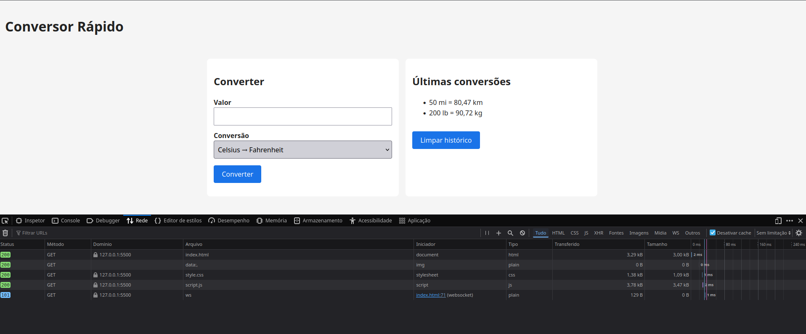
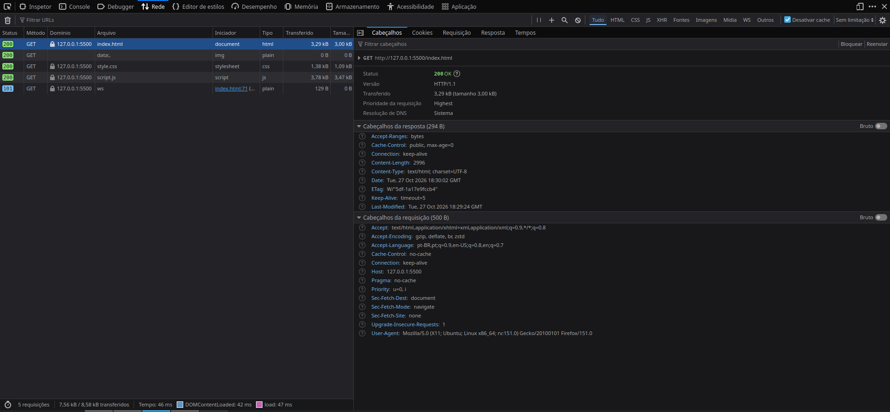

# Conversor Rápido

Aplicação web, feita para a disciplina Desenvolvimento de Sistemas Web (UFMA), que converte valores entre unidades de temperatura, distância e massa.

## O que o app faz

- Converte um valor digitado usando uma de 6 conversões: °C → °F, °F → °C, km → mi, mi → km, kg → lb e lb → kg.
- Mostra o resultado no formato `25 °C = 77 °F`, com até 2 casas decimais e sem zeros desnecessários.
- Aceita números negativos e decimais com vírgula ou ponto (`1,5` ou `1.5`).
- Mostra "Digite um número válido" quando a entrada está vazia ou não é um número.
- Guarda as 5 conversões mais recentes na seção "Últimas conversões", salvas no `localStorage` (continuam lá depois de recarregar a página), com um botão para limpar o histórico.

Feito apenas com HTML, CSS e JavaScript puros, sem frameworks ou bibliotecas.

## Como rodar

Escolha uma das opções:

- **Live Server (VS Code):** instale a extensão Live Server, abra a pasta do projeto, clique com o botão direito em `index.html` e escolha "Open with Live Server".
- **Python:** na pasta do projeto, rode

  ```bash
  python -m http.server 8000
  ```

  e abra http://localhost:8000 no navegador.

## Estrutura

| Arquivo | Conteúdo |
|---|---|
| `index.html` | Estrutura da página (header, main, sections, footer) |
| `style.css` | Estilos, mobile-first, com media query para telas a partir de 768px |
| `script.js` | Conversões, validação, formatação e histórico |

## Uso de IA

O projeto foi desenvolvido em etapas, alternando entre etapas implementadas pelo Claude (Anthropic), assistente de IA, e etapas implementadas por mim. Vale destacar que todos os commits com co-autoria do Claude foram revisados por mim, alguns inclusive com múltiplas edições e correções. Os commits feitos com a ajuda do Claude têm a linha `Co-Authored-By: Claude` na mensagem. Nas minhas etapas, o Claude apenas revisou o `git diff`, sem editar os arquivos.

**Implementadas pelo Claude:**

1. Estrutura inicial do `index.html`
2. Conversão de Celsius para Fahrenheit (`script.js`)
3. Refatoração das fórmulas para um objeto de conversões
4. As outras 5 conversões e as opções do select
5. Validação de entrada vazia e não numérica
6. Histórico no `localStorage`
7. Limite de 5 itens e tratamento de erro na leitura do histórico
8. Acessibilidade (`aria-live`, foco visível, `lang="pt-BR"`)
9. Primeira versão deste README

**Implementadas por mim:**

1. Estilos básicos (`style.css`)
2. Correção para aceitar vírgula como separador decimal
3. Botão "Limpar histórico"
4. Layout responsivo
5. Revisão da seção "Uso de IA" e seção "Aba Rede"
6. Formatação do resultado com unidades e duas casas decimais

## Aba Rede



Ao abrir a página, o navegador faz a requisição abaixo para carregar o `index.html`:

- **Método:** `GET`
- **URL:** `http://127.0.0.1:5500/index.html` (servidor local do Live Server)
- **Status:** `200 OK`, ou seja, o arquivo foi entregue com sucesso



As outras requisições (`style.css` e `script.js`) também retornam 200. Como o app segue a trilha C (sem API), não há chamadas a APIs externas: a conversão é feita no próprio JavaScript e o histórico fica no `localStorage` do navegador.
